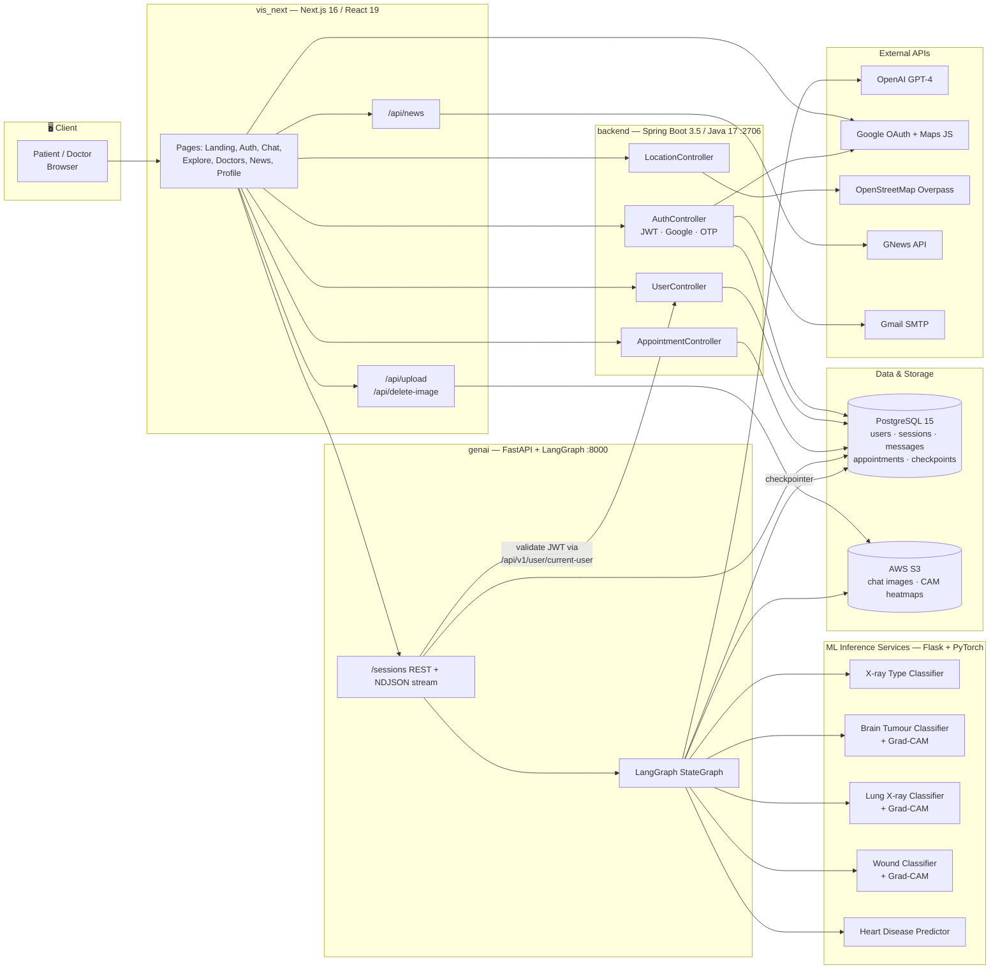
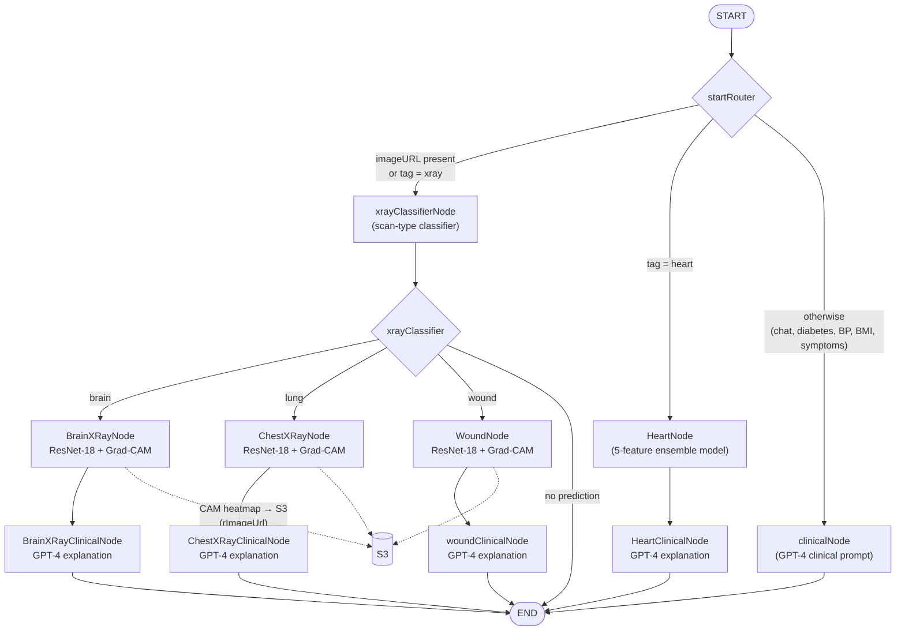
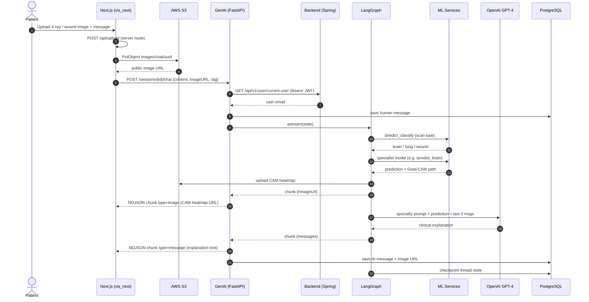
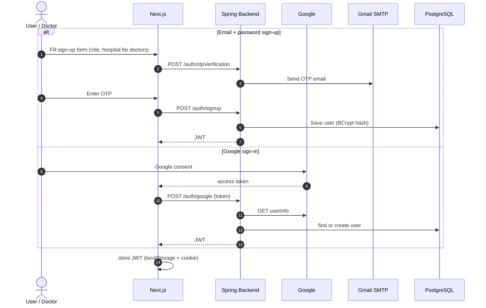
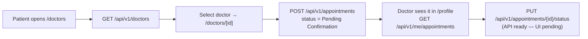
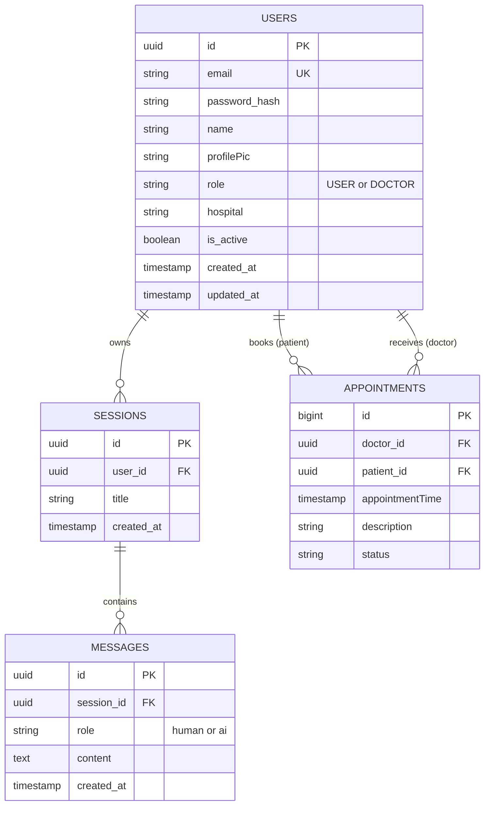
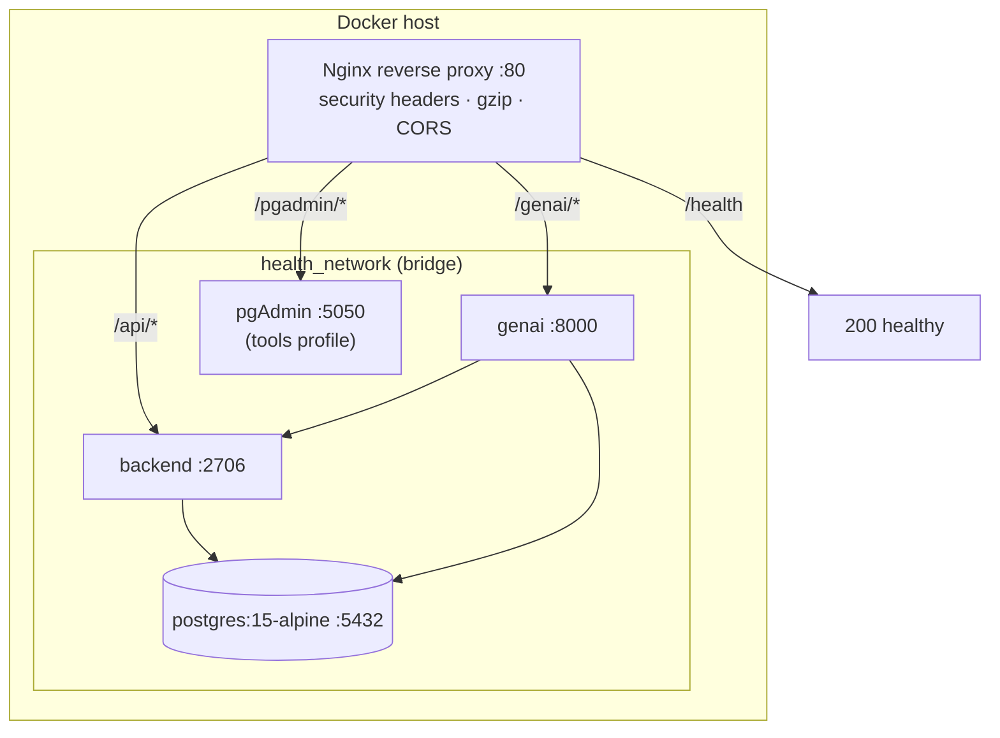
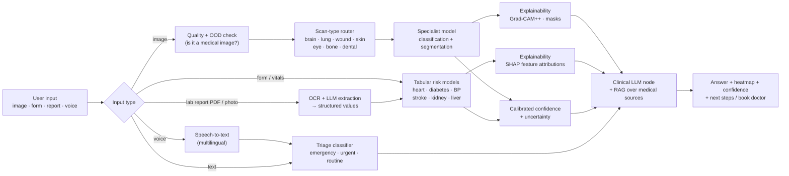

# 🩺 Jivika AI — Project Overview

> **Status: 🚧 Under production.** Jivika AI is in active development and is not publicly released yet. This document has no deployment links or demo URLs on purpose. It covers what has been built so far and what is planned next.

Jivika AI is an AI-powered healthcare assistant. It brings together four things:

- a **Generative-AI medical chatbot** (LangGraph + OpenAI)
- **deep-learning diagnostics** for brain MRI, chest X-ray, wound images and heart-disease risk
- a **doctor ↔ patient portal** for booking appointments
- **real-world tools**: a nearby-hospital finder and a live health-news feed

---

## 📑 Table of Contents

1. [High-Level Architecture](#-high-level-architecture)
2. [Repository Structure](#-repository-structure)
3. [Module 1 — Frontend (`vis_next`)](#-module-1--frontend-vis_next)
4. [Module 2 — Core Backend (`backend`)](#-module-2--core-backend-backend)
5. [Module 3 — GenAI Service (`genai`)](#-module-3--genai-service-genai)
6. [Module 4 — Machine Learning (`ML`)](#-module-4--machine-learning-ml)
7. [Key Flows](#-key-flows)
8. [Data Model](#-data-model)
9. [Infrastructure & DevOps](#-infrastructure--devops)
10. [Environment Variables](#-environment-variables)
11. [What We Have Added ✅](#-what-we-have-added)
12. [What We Have to Add 🔭 (Roadmap)](#-what-we-have-to-add-roadmap)
13. [ML Expansion Ideas 🧪](#-ml-expansion-ideas)
14. [Known Issues / Tech Debt](#-known-issues--tech-debt)

---

## 🏗 High-Level Architecture



---

## 📂 Repository Structure

```text
JivikaAI/
├── vis_next/                    # Frontend — Next.js 16 (App Router) + Tailwind v4 + shadcn/ui
│   ├── app/
│   │   ├── page.tsx             # Landing page (hero, offers, FAQ, footer…)
│   │   ├── layout.tsx           # Root providers: GoogleOAuth, Map, Theme, AuthGuard
│   │   ├── auth/                # Sign-in / sign-up for users & doctors, OTP screen
│   │   │   ├── user/  doctor/  _components/ (userAuthPage, doctorAuthPage, optpage, otpInput)
│   │   ├── chat/                # AI chat (new chat + /chat/[id] streaming conversation)
│   │   │   └── HeartForm · DiabetesForm · BloodPressureForm · BMIForm · SymptomForm
│   │   ├── explore/             # Google Maps hospital finder (OSM data via backend)
│   │   ├── doctors/             # Doctor directory + /doctors/[id] appointment booking
│   │   ├── news/                # Health news feed (GNews) with carousel & cards
│   │   ├── profile/             # Profile, edit profile, appointment list, location
│   │   ├── api/                 # Next.js route handlers: upload, delete-image, news
│   │   ├── components/          # Chatbox (Sidebar, ChatMessage…), landing sections, common UI
│   │   ├── context/             # UserContext, MapContext, ThemeContext (4 themes)
│   │   └── Varibles/            # Landing-page copy/constants
│   ├── components/ui/           # shadcn/ui primitives + typography
│   ├── hooks/                   # useUser, useIsMobile
│   ├── lib/                     # auth-utils (token cookie/localStorage), auth, aws, utils
│   └── middleware.ts            # Route protection for /chat, /explore, /profile
│
├── backend/                     # Core API — Spring Boot 3.5.7, Java 17, Maven
│   └── src/main/java/com/pearl/backend/
│       ├── controllers/         # Auth, User, Appointment, Location
│       ├── services/            # AuthService, JwtService, JwtAuthFilter, EmailService, OSMService, UpdateProfile
│       ├── entities/            # Users, Appointment, Session, Message (JPA)
│       ├── repositories/        # UserRepository, AppointmentRepository
│       ├── auth/  medical/      # Request/response DTOs
│       └── configurations/      # Security, CORS, Mail, App (BCrypt, RestTemplate)
│
├── genai/                       # GenAI service — FastAPI + LangGraph + SQLAlchemy
│   ├── app/
│   │   ├── server.py            # FastAPI app, lifespan (DB tables, Postgres checkpointer, graph compile)
│   │   ├── graph.py             # LangGraph StateGraph definition
│   │   ├── nodes.py             # Clinical LLM nodes + ML inference nodes
│   │   ├── routers.py           # Conditional routing logic (start + x-ray type)
│   │   ├── prompts.py           # System prompts per specialty
│   │   ├── state.py             # ChatStateMain (messages, imageURL, prediction, rImageUrl, request)
│   │   ├── models.py  crud.py  db.py   # SQLAlchemy models + CRUD
│   │   ├── clients.py           # OpenAI, S3 & DB config
│   │   ├── main.py              # CLI test harness for the graph
│   │   └── api/                 # routers.py (sessions/chat endpoints), schemas.py
│   ├── langgraph.json           # LangGraph Studio config
│   ├── requirements.txt
│   └── Dockerfile
│
├── ML/                          # Model training & inference servers
│   ├── Notebooks/               # brain-tumor, lung-xray-classification, wound, heart-attack-pred
│   ├── Brain.py  lung.py  wound_class.py  xray_classifier.py  Heart.py   # Flask inference APIs
│   └── *.pth / *.pkl            # Trained weights (ResNet-18 ×4, sklearn ensemble ×1)
│
├── docker-compose.yml           # postgres + backend + genai (+ pgadmin profile)
├── docker-compose.prod.yml
├── nginx.conf                   # Reverse proxy: /api → backend, /genai → genai
└── .env.example
```

---

## 🖥 Module 1 — Frontend (`vis_next`)

**Stack:** Next.js 16 (App Router), React 19, TypeScript, Tailwind CSS v4, shadcn/ui (Radix), Framer Motion, GSAP, Axios, `@react-google-maps/api`, `@react-oauth/google`, AWS SDK v3.

### Pages & features

| Route | Feature |
|---|---|
| `/` | Animated landing page: preloader, hero, offers, feature sections, intro, FAQ, footer |
| `/auth`, `/auth/user`, `/auth/doctor` | Separate sign-up/sign-in for **patients** and **doctors** (doctors also give a hospital), Google sign-in, OTP email verification, password reset |
| `/chat` | New-chat screen with suggestion prompts and a **Health Tools** menu |
| `/chat/[id]` | Conversation view. It streams the response (NDJSON), shows images and Grad-CAM heatmaps inline, and supports image upload |
| `/explore` | **Hospital finder**: browser geolocation → backend OSM query → Google Map markers + searchable list |
| `/doctors` | Directory of registered doctors |
| `/doctors/[id]` | Appointment booking form (date/time, description) |
| `/news` | Health news from GNews, with a featured carousel, modern news cards and auto-categorisation |
| `/profile` | Profile card, edit profile (name, photo, password), current location, and appointments (from the patient or doctor side, depending on role) |

### Health Tools (chat menu)

| Tool | Type | Backed by |
|---|---|---|
| ❤️ Heart Health Assessment | ML | Heart ensemble model → LLM explanation |
| 🩻 X-ray / Wound Image Upload | ML | X-ray type classifier → Brain / Lung / Wound model → LLM explanation |
| 🩸 Diabetes Risk Check | Non-ML (form → LLM) | Clinical LLM node |
| 💓 Blood Pressure Analysis | Non-ML (form → LLM) | Clinical LLM node |
| ⚖️ BMI Calculator | Non-ML (form → LLM) | Clinical LLM node |
| 📋 Symptom Checker | Non-ML (form → LLM) | Clinical LLM node |

### Cross-cutting

- **Auth:** the JWT is stored in `localStorage` and in a `__Pearl_Token` cookie. `middleware.ts` (server-side) and `AuthGuard` (client-side) both protect `/chat`, `/explore` and `/profile`.
- **Image uploads:** go through server-side Next.js routes (`/api/upload`), so AWS credentials never reach the browser. The routes check file type and enforce a 10 MB limit.
- **Theming:** four themes (`light`, `dark`, `rose`, `thunder`), remembered in localStorage.
- **Chat sidebar:** lists sessions, lets you rename or delete them, and has quick links to Explore, News, Doctors and Profile. It has a separate mobile layout.

---

## ⚙ Module 2 — Core Backend (`backend`)

**Stack:** Spring Boot 3.5.7, Java 17, Spring Security (stateless JWT), Spring Data JPA (Hibernate, `ddl-auto: update`), PostgreSQL, JJWT 0.11.5, Spring Mail, Lombok, BCrypt. **Port:** `2706`.

### REST API

| Method | Endpoint | Purpose |
|---|---|---|
| `POST` | `/api/v1/auth/signup` | Register a user or doctor (role, optional hospital) → JWT |
| `POST` | `/api/v1/auth/signin` | Email + password → JWT |
| `POST` | `/api/v1/auth/google` | Exchange a Google access token for a JWT (creates the user if new) |
| `POST` | `/api/v1/auth/otpVerification` | Send an OTP email through Gmail SMTP |
| `POST` | `/api/v1/auth/reset-password` | Set a new password |
| `GET` | `/api/v1/user/current-user` | Profile of the authenticated user (also used by GenAI for auth) |
| `PUT` | `/api/v1/user/update-profile` | Update name, photo, password |
| `GET` | `/api/v1/doctors` | List all users with role `DOCTOR` |
| `POST` | `/api/v1/appointments` | Book an appointment (status: *Pending Confirmation*) |
| `GET` | `/api/v1/me/appointments` | Appointments for the current doctor or patient |
| `PUT` | `/api/v1/appointments/{id}/status` | Doctor updates an appointment's status |
| `GET` | `/api/v1/places/nearby-osm` | Nearby hospitals through the OpenStreetMap Overpass API |

### Security flow

`JwtAuthFilter` reads `Authorization: Bearer <token>` and validates it with HS256 (7-day expiry). It then loads `Users` by email and puts the user in the `SecurityContext`.

---

## 🤖 Module 3 — GenAI Service (`genai`)

**Stack:** FastAPI, LangGraph 1.0, LangChain-OpenAI (GPT-4, temperature 0), `AsyncPostgresSaver` checkpointer, SQLAlchemy + psycopg 3, boto3 (S3). **Port:** `8000`.

### API

| Method | Endpoint | Purpose |
|---|---|---|
| `POST` | `/sessions/` | Create a chat session |
| `GET` | `/sessions/` | List the user's sessions |
| `PATCH` | `/sessions/{id}` | Rename a session |
| `DELETE` | `/sessions/{id}` | Delete a session and its messages |
| `GET` | `/sessions/{id}/messages` | Chat history. Starts **auto title generation** in the background for chats still named "New Chat" |
| `POST` | `/sessions/{id}/chat` | Send `{content, imageURL?, tag?}` → **streamed NDJSON** chunks `{type: message \| image \| error, content}` |

Every request is authenticated by sending the caller's bearer token to the backend's `/api/v1/user/current-user`. Session ownership is checked on every call.

### LangGraph workflow



**State (`ChatStateMain`):** `messages`, `imageURL`, `prediction`, `rImageUrl` (Grad-CAM heatmap URL), `request` (tool tag), `output`.

Each clinical node sends GPT-4 a specialty system prompt with the model's prediction filled in, plus the **last 3 messages** as context.

---

## 🧠 Module 4 — Machine Learning (`ML`)

Every image model uses **ResNet-18** (ImageNet-pretrained, fine-tuned). Images are resized to 256, centre-cropped to 224 and ImageNet-normalised. Brain, lung and wound predictions come with a **Grad-CAM** heatmap from `layer4[-1]`, laid over the input image. Each model runs as its own **Flask** inference service.

| Model | Service / Route | Classes | Training notes | Result (from notebooks) |
|---|---|---|---|---|
| **Scan-type classifier** | `xray_classifier.py` → `/predict_classify` | wound · brain · lung | ResNet-18, 3-way head; routes the image to the right specialist model | — |
| **Brain tumour (MRI)** | `Brain.py` → `/predict_brain` | glioma · meningioma · no_tumor · pituitary | 20 epochs, Adam 1e-4; also tried LR / XGBoost on embeddings | Val acc up to **~99.6%** (LogReg on embeddings 99.2%) |
| **Lung / chest X-ray** | `lung.py` → `/predict_lung` | COVID · HEALTHY · PNEUMONIA | 80/20 split, augmentation, dropout 0.30, Optuna-tuned LR | Test acc **~95%** (macro F1 0.95) |
| **Wound type** | `wound_class.py` → `/predict_wound` | Abrasions · Bruises · Burns · Cut · Ingrown_nails · Laceration · Stab_wound | Offline augmentation (×3 train / ×2 test), Optuna search (lr, optimiser, dropout) | Test acc **~95%** (macro F1 0.95) |
| **Heart disease** | `Heart.py` → `/predict` | 0 = low risk · 1 = risk | Soft-voting ensemble (LogReg + RandomForest + XGBoost), Optuna-tuned. Features chosen by RF importance | ~**85%** with top-5 features (~87% with all 11) |

**Heart model input (5 features):** `MaxHR`, `ChestPainType (0–2)`, `Cholesterol`, `Oldpeak`, `ST_Slope`.

**Artifacts:** `Brain_Xray_Classification.pth`, `lung_xray_classify.pth`, `woundd.pth`, `resnet18_brain_tumor.pth` (scan-type classifier), `Heart_model.pkl`.

---

## 🔄 Key Flows

### 1. Image diagnosis chat (end-to-end)



### 2. Authentication



### 3. Appointment booking



---

## 🗄 Data Model



> The Spring backend and the GenAI service both map the **same** `users`, `sessions` and `messages` tables. LangGraph keeps its own checkpoint tables in the same database.

---

## 🐳 Infrastructure & DevOps



- **Backend Dockerfile:** multi-stage Maven build → `eclipse-temurin:17-jre`
- **GenAI Dockerfile:** `python:3.11-slim` → `uvicorn app.server:app`
- **Compose:** Postgres with a healthcheck; backend and genai start only after the DB is healthy. Log volumes are persisted.
- **Frontend** and **ML services** run outside the compose stack for now.

---

## 🔐 Environment Variables

| Service | Variables |
|---|---|
| **backend** | `DB_URL`, `DB_USERNAME`, `DB_PASSWORD`, `JWT_SECRET`, `GOOGLE_CLIENT_ID`, `GOOGLE_CLIENT_SECRET`, `SMTP_PORT`, `SMTP_MAIL`, `APP_PASSWORD`, `GOOGLE_MAPS_API_KEY` |
| **genai** | `PSQL_USERNAME`, `PSQL_PASSWORD`, `PSQL_HOST`, `PSQL_PORT`, `PSQL_DATABASE`, `PSQL_SSLMODE`, `DATABASE_URL`, `OPENAI_API_KEY`, `AWS_ACCESS_KEY_ID`, `AWS_SECRET_ACCESS_KEY`, `AWS_DEFAULT_REGION`, `BACKEND_URL`, `LANGCHAIN_TRACING_V2`, `LANGCHAIN_API_KEY`, `LANGCHAIN_PROJECT` |
| **vis_next** | `NEXT_PUBLIC_BACKEND_URL`, `NEXT_PUBLIC_FASTAPI_BACKEND_URL`, `NEXT_PUBLIC_GOOGLE_MAPS_API_KEY`, `GNEWS_API_KEY`, `AWS_REGION`, `AWS_S3_BUCKET`, `AWS_ACCESS_KEY_ID`, `AWS_SECRET_ACCESS_KEY` |

---

## ✅ What We Have Added

### Frontend
- [x] Animated landing page with preloader, sections and FAQ
- [x] Separate patient and doctor sign-up/sign-in, Google OAuth, OTP email screen, password reset
- [x] Route protection (Next middleware + client AuthGuard)
- [x] Chat UI with session sidebar (create / rename / delete), streaming replies, and inline images and heatmaps
- [x] Six Health Tools: Heart, X-ray/Wound upload, Diabetes, Blood Pressure, BMI, Symptom Checker
- [x] Secure server-side S3 image upload with type and size checks
- [x] Hospital finder on Google Maps using OSM data
- [x] Health-news page using GNews (5-min cache, auto-categorised)
- [x] Doctor directory and appointment booking
- [x] Profile page with editing, location and role-aware appointment list
- [x] Four colour themes and a responsive mobile layout

### Backend
- [x] JWT auth (HS256, 7 days), BCrypt password hashing
- [x] Google OAuth token exchange, OTP email through SMTP
- [x] User profile read/update
- [x] Doctor listing, appointment create/list/status-update APIs
- [x] OpenStreetMap nearby-hospital proxy
- [x] CORS and stateless security config, Dockerfile

### GenAI
- [x] LangGraph multi-node medical agent with conditional routing
- [x] Specialty system prompts (general clinical, brain, lung, wound, heart)
- [x] Persistent conversation memory (Postgres checkpointer)
- [x] Session and message persistence, ownership checks, auto title generation
- [x] NDJSON streaming of text and images
- [x] Grad-CAM heatmaps stored in S3 and returned to the chat
- [x] Auth delegated to the backend, Dockerfile, LangGraph Studio config

### Machine Learning
- [x] Scan-type router model (brain / lung / wound)
- [x] Brain tumour classifier (4 classes, ~99% val acc) + Grad-CAM
- [x] Chest X-ray classifier (COVID / Healthy / Pneumonia, ~95%) + Grad-CAM
- [x] Wound classifier (7 classes, ~95%) + Grad-CAM
- [x] Heart-disease ensemble (LR + RF + XGBoost, Optuna-tuned, ~85%)
- [x] Training notebooks for every model, and Flask inference APIs

### DevOps
- [x] Docker Compose (Postgres, backend, genai, optional pgAdmin)
- [x] Nginx reverse-proxy config with security headers and gzip

---

## 🔭 What We Have to Add (Roadmap)

```mermaid
flowchart LR
    subgraph P1["Phase 1 — Hardening"]
        A1["Server-side OTP<br/>generation + expiry"]
        A2["Protect reset-password<br/>with verified OTP"]
        A3["Role-based access<br/>(USER / DOCTOR)"]
        A4["Fix Appointment ID type"]
        A5["Move hard-coded config<br/>to env vars"]
    end
    subgraph P2["Phase 2 — Product"]
        B1["Doctor accept / reject<br/>appointment UI"]
        B2["Email notifications<br/>for appointments"]
        B3["Confidence scores<br/>in predictions"]
        B4["Token-level LLM streaming"]
        B5["Chat history: render<br/>stored images properly"]
    end
    subgraph P3["Phase 3 — Intelligence"]
        C1["ML models for diabetes<br/>& blood pressure"]
        C2["RAG over medical<br/>knowledge (pgvector)"]
        C3["Unified FastAPI<br/>inference service"]
        C4["Medical report / PDF<br/>analysis"]
    end
    subgraph P4["Phase 4 — Production"]
        D1["Frontend + ML in<br/>Docker Compose"]
        D2["CI/CD pipeline"]
        D3["Automated tests"]
        D4["Monitoring & logging"]
        D5["Private S3 +<br/>presigned URLs"]
    end
    P1 --> P2 --> P3 --> P4
```



### Detailed backlog

**Security & auth**
- [ ] Generate and check OTPs **on the server**, with expiry and a retry limit (today the browser generates them and keeps them in localStorage)
- [ ] Require a verified OTP or reset token before `/auth/reset-password` accepts a new password
- [ ] Tighten `SecurityConfig`: today it allows all of `/api/v1/**`. Add role-based `GrantedAuthority` for `DOCTOR` and `USER`
- [ ] Move to an httpOnly cookie for the JWT, and add refresh tokens
- [ ] Move hard-coded values (OAuth client ID, the GenAI → backend URL, CORS origins, mail sender) into env config
- [ ] Rate-limit auth and chat endpoints

**Product features**
- [ ] UI for doctors to **confirm, reject or complete** appointments (the API already exists)
- [ ] Appointment email/SMS notifications and reminders
- [ ] Doctor availability slots and calendar view
- [ ] Return **confidence/probability** with every ML prediction and show it in the UI
- [ ] Re-render stored image and heatmap messages correctly when old chats load
- [ ] Forward all Health-Tool tags (diabetes, BP, BMI, symptoms) from `/chat/[id]` too, not only `heart` and `xray`
- [ ] Downloadable chat or diagnosis summary report (PDF)
- [ ] Multilingual support (Hindi and regional languages)
- [ ] Rename leftover template components (`FinancialFreedom`, `FinancialFuture`) and set real page metadata

**AI / ML**
- [ ] Dedicated ML models for **diabetes** and **blood pressure** risk (these are LLM-only today)
- [ ] **RAG** with `pgvector` (already a dependency) over trusted medical sources
- [ ] Token-by-token LLM streaming instead of one chunk per node
- [ ] Make the LLM model configurable and move to a newer model
- [ ] Add an "out-of-distribution / not a medical image" class to the scan-type router
- [ ] Merge the five Flask apps into **one FastAPI inference service** with model registry and versioning
- [ ] Add responsible-AI guardrails: emergency-symptom escalation, and disclaimers wherever clinical review needs them
- [ ] Dataset and model cards, evaluation reports, bias checks

**DevOps & quality**
- [ ] Add a frontend Dockerfile and put the frontend and ML services in Docker Compose
- [ ] CI/CD (lint, test, build, deploy)
- [ ] Unit and integration tests (JUnit, pytest, Playwright)
- [ ] HTTPS / TLS config and production Nginx hardening
- [ ] Centralised logging, metrics and alerting
- [ ] Private S3 bucket with presigned URLs, plus a cleanup policy for uploaded images
- [ ] Stop committing `.langgraph_api/*.pckl`, `.DS_Store` and IDE folders; use Git LFS or a model registry for weights

---

## 🧪 ML Expansion Ideas

These ideas build on what the ML module already has: ResNet-18 transfer learning, Grad-CAM, sklearn/XGBoost ensembles with Optuna, and LangGraph routing to a specialist model. Each new model plugs into the graph the same way: **router → model node → clinical LLM node**.

### Target ML pipeline



### 1. New diagnostic models

| Idea | Type | Public dataset (Kaggle / research) | Fits existing pipeline |
|---|---|---|---|
| **Diabetes risk** | Tabular | Pima Indians Diabetes, CDC Diabetes Health Indicators | The `DiabetesForm` exists but has no model; reuse the heart ensemble + Optuna recipe |
| **Hypertension / BP risk** | Tabular | Cardiovascular Disease dataset (70k records) | The `BloodPressureForm` exists but has no model |
| **Stroke risk** | Tabular | Stroke Prediction dataset | Extra heart-health tool |
| **Chronic kidney / liver disease** | Tabular | UCI CKD, Indian Liver Patient | New Health-Tool forms |
| **Brain tumour segmentation** | Segmentation (U-Net) | Same brain dataset already used — it has a **segmentation** folder | Draw the tumour outline + estimate its size, not just a class |
| **Skin lesion / skin cancer** | Image classification | HAM10000, ISIC | Same ResNet + Grad-CAM recipe as wounds |
| **Tuberculosis on chest X-ray** | Image classification | TBX11K, Shenzhen / Montgomery | Add a 4th class to the lung model |
| **Multi-label chest X-ray** | Multi-label classification | NIH ChestX-ray14, CheXpert | Detect several findings at once (effusion, cardiomegaly…) |
| **Bone fracture** | Image classification | MURA, bone-fracture X-ray sets | New branch in the scan-type router |
| **Diabetic retinopathy** | Image classification (graded 0–4) | APTOS 2019, EyePACS | Links with the diabetes tool |
| **Kidney stone / cyst / tumour (CT)** | Image classification | CT Kidney dataset | New router branch |
| **Breast ultrasound** | Classification + segmentation | BUSI | New router branch |
| **Dental X-ray** | Detection | Dental panoramic datasets | New router branch |
| **ECG arrhythmia** | 1D CNN / time series | MIT-BIH, PTB-XL | Upload an ECG image or signal |
| **Wound severity / healing tracking** | Segmentation + regression | Wound segmentation datasets | Measure wound area over time across chat sessions |

### 2. Make the current models better

- **Confidence scores:** return softmax probabilities, calibrated with temperature scaling, and show the top-3 classes in the UI and pass them to the LLM prompt.
- **Out-of-distribution rejection:** add a "not a medical image / unclear" class or an energy-based OOD score, so a selfie never gets a tumour label.
- **Uncertainty:** use Monte-Carlo dropout or test-time augmentation. When confidence is low, reply "please consult a doctor" and suggest booking one.
- **Stronger backbones:** try EfficientNet, ConvNeXt or ViT. Also try medical-pretrained encoders (for example TorchXRayVision for chest X-rays, BiomedCLIP-style models) instead of ImageNet.
- **Better evaluation:** report sensitivity, specificity, AUROC and per-class F1, not only accuracy. Use a **held-out test set that was never augmented or used for model selection**. Today the wound test set is augmented ×2, and the brain "val" set is used both for picking the model and for reporting, so the reported numbers are likely optimistic.
- **Class imbalance:** weighted loss or focal loss, stratified k-fold cross-validation.
- **Heart model:** add SHAP values so the LLM can explain *which* inputs raised the risk. Use all 11 features when the form provides them.
- **Explainability upgrades:** Grad-CAM++ / Score-CAM, plus segmentation masks where available.

### 3. GenAI + ML combined

- **Lab-report reader:** OCR on an uploaded report photo or PDF, then LLM extraction of values (glucose, HbA1c, cholesterol, BP). Feed those into the tabular risk models automatically.
- **Triage classifier:** a small text model that flags emergency symptoms (chest pain, stroke signs) and makes the reply say "go to a hospital now". It can link to the hospital finder.
- **RAG:** store trusted medical guidelines in `pgvector` (already a dependency), so clinical answers cite sources.
- **Vision-LLM second opinion:** a multimodal LLM describes the image, and its answer is checked against the CNN prediction. When they disagree, confidence is lowered.
- **Voice input:** multilingual speech-to-text (Hindi and regional languages) for accessibility.
- **Doctor matching:** a recommender that suggests a doctor specialty from the diagnosis (for example glioma → neurologist), then goes straight to booking.

### 4. Personal health tracking

- **Risk trends:** save each prediction per user and chart heart, diabetes and BP risk over time on the profile page.
- **Wearable data:** import heart rate, steps and sleep, and detect anomalies (isolation forest or LSTM autoencoder).
- **Medication reminders + drug-interaction checks** using a public drug-interaction dataset.

### 5. MLOps

- **One inference service:** merge the five Flask apps into a single FastAPI service that loads all models once and exposes `/predict/{model}`.
- **Faster, cheaper inference:** export to ONNX / TorchScript, quantise to INT8 for CPU, batch requests.
- **Experiment tracking & registry:** MLflow (or Weights & Biases) for runs, metrics and model versions. DVC or Git LFS for datasets and `.pth` weights instead of committing them.
- **Reproducible training:** turn the Kaggle notebooks into scripts with fixed seeds and config files.
- **Monitoring:** log prediction distribution and confidence, detect data drift, and collect doctor feedback ("was this correct?") to build a labelled set for retraining.
- **Model cards:** one per model, covering the dataset, metrics, limitations and intended use.

### Suggested priority

| Priority | Idea | Why first |
|---|---|---|
| 🔴 High | Confidence scores + OOD rejection | Safety: stops wrong labels on non-medical images |
| 🔴 High | Clean held-out evaluation + AUROC/sensitivity | Trustworthy numbers for every model |
| 🔴 High | Diabetes + BP models | The forms already exist, so only the model is missing |
| 🟠 Medium | Brain tumour segmentation | Dataset already downloaded, big visual upgrade |
| 🟠 Medium | Unified FastAPI inference service + ONNX | Simpler deployment, lower latency |
| 🟠 Medium | Lab-report OCR → tabular models | Connects GenAI and ML in one flow |
| 🟢 Later | Skin, eye, bone, ECG models | New router branches once the pipeline is solid |
| 🟢 Later | Wearables, risk trends, MLflow | Long-term product and platform features |

---

## 🐞 Known Issues / Tech Debt

| Area | Issue |
|---|---|
| backend | `Appointment.id` is a `Long` but `AppointmentRepository` is typed `JpaRepository<Appointment, UUID>` and the controller parses IDs as UUIDs |
| backend | `AuthController.signin` calls `authService.signin()` twice (once just to log it) |
| backend | `JwtAuthFilter` throws if the token's user is missing instead of returning 401 |
| genai | `BACKEND_URL` is hard-coded to `localhost` in `api/routers.py`, so the Docker env var is ignored |
| genai | `main.py` uses `TEST_IMAGE_URLS` but never defines it (it is a CLI test harness only) |
| genai | `HeartNode` returns the whole state when it fails, with no message for the user |
| ML | `lung.py` saves `cam_<file>` but returns `/static/lung_cam_<file>` |
| ML | Uploaded file names are used directly in file paths (no sanitising) |
| frontend | `[id]` chat page forwards only `heart` and `xray` tags |
| repo | The root `README.md` says "GraphQL", but the backend is REST |

---

<p align="center"><b>Jivika AI</b> — 🚧 under production. Built by Saumya Sood, Vishwas Pahwa, Kyan Mahajan and Vaidik Kathal.</p>
